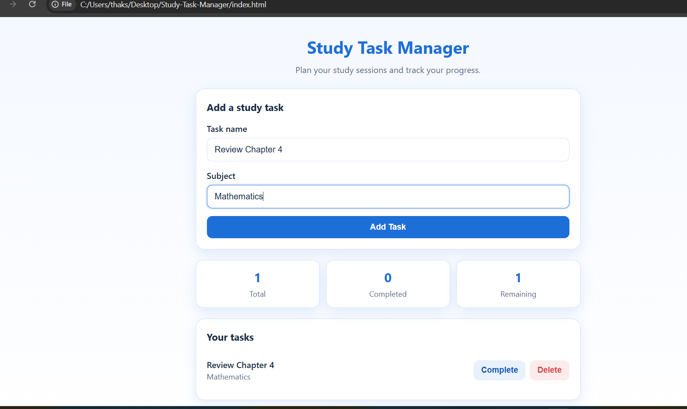

# Study Task Manager

A simple and responsive web application to manage study tasks and track study progress.

## Features

- Add study tasks with a task name and subject.
- Mark tasks as complete.
- Delete tasks.
- View total, completed, and remaining task counts.
- Save tasks in the browser using localStorage.
- Clean blue-and-white user interface.

## Technologies Used

- HTML5
- CSS3
- JavaScript
- Browser localStorage

## How to Run

1. Clone or download this repository.
2. Open the project folder.
3. Open `index.html` in your web browser.
4. Add study tasks and track your progress.

## Project Purpose

This project was created as part of the MLH Global Hack Week Challenge 1: Build a Mini App with Cursor.

Cursor AI helped with generating, testing, and improving the application.

## Author

GitHub: [thakshilaprasadani311-ship-it](https://github.com/thakshilaprasadani311-ship-it)
## App Screenshot

